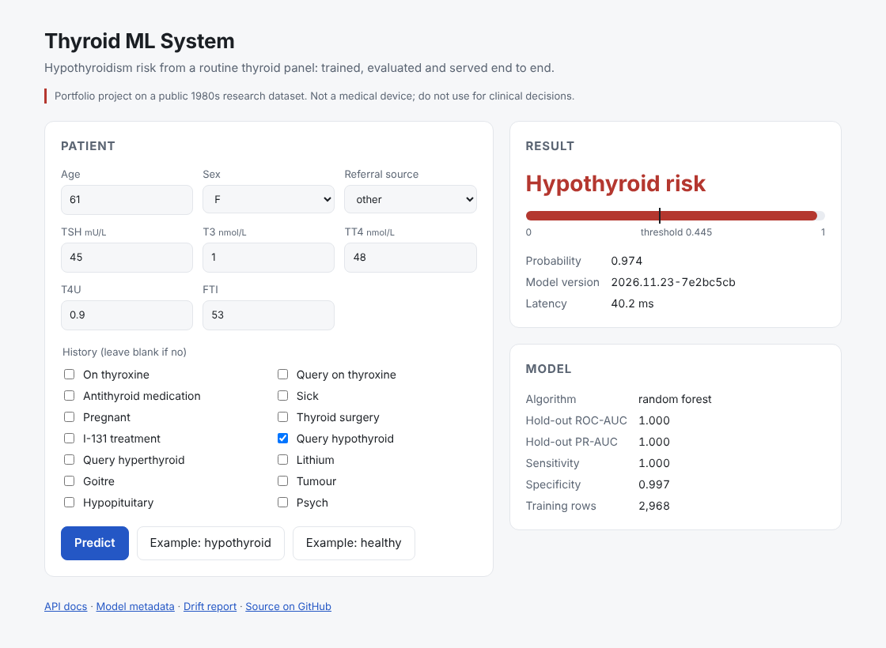
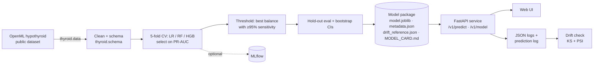

# Thyroid ML System

[](https://github.com/lonewolf1621/thyroid-ml-system/actions/workflows/ci.yml)


End-to-end ML system that predicts **hypothyroidism** from a routine thyroid panel: reproducible training
on a public dataset, model selection with cross-validation, a FastAPI service with a web UI, input-drift
monitoring, and a CI pipeline that trains the model and smoke-tests the container on every push.

**Live demo:** _add your Render / Cloud Run URL here_ · **API docs:** `/docs` on any running instance



> Portfolio project on a public 1980s research dataset. Not a medical device; not for clinical decisions.

## Results

Trained on the public [UCI / OpenML hypothyroid dataset](https://www.openml.org/d/57): 3,711 records after
de-duplication, 7.8% positive. Numbers below come from the CI run; every build regenerates them in
[`models/MODEL_CARD.md`](#model-card) and `GET /v1/model`.

**Model selection** (5-fold stratified CV on the 80% training split):

| Model | ROC-AUC | PR-AUC |
|---|---|---|
| Logistic regression | 0.989 ± 0.005 | 0.875 ± 0.036 |
| **Random forest** (selected) | **0.999 ± 0.001** | **0.987 ± 0.007** |
| Histogram gradient boosting | 0.997 ± 0.004 | 0.982 ± 0.019 |

**Hold-out test set** (743 records, used once, threshold 0.445):

| Sensitivity | Specificity | Precision | ROC-AUC | Confusion matrix |
|---|---|---|---|---|
| 1.000 (58/58) | 0.997 | 0.967 | 1.000 (95% CI 1.000–1.000) | TN 683 · FP 2 · FN 0 · TP 58 |

Why so high? The original labels were assigned by clinicians largely from these same lab values (TSH, FTI,
TT4), so the model mostly re-learns reference ranges. The engineering around the model is the point of this
project; see [Limitations](#limitations).

## Architecture



## Run it

**Docker (any machine, nothing else to install):**

```bash
git clone https://github.com/lonewolf1621/thyroid-ml-system.git && cd thyroid-ml-system
docker compose up --build        # trains the model during the build, then serves it
# open http://localhost:8000
```

**Local Python:**

```bash
python -m venv .venv && source .venv/bin/activate   # Windows: .venv\Scripts\activate
pip install -r requirements-dev.txt
make train      # downloads the dataset and trains (~30 s); or: python -m thyroid.train
make serve      # http://localhost:8000
make test       # offline test suite on synthetic data
```

## API

```bash
curl -X POST localhost:8000/v1/predict -H "Content-Type: application/json" \
  -d '{"age": 61, "sex": "F", "TSH": 45, "T3": 1.0, "TT4": 48, "T4U": 0.9, "FTI": 53, "query_hypothyroid": true}'
```

```json
{"probability_hypothyroid": 0.9738, "prediction": "hypothyroid", "threshold": 0.4449, "model_version": "2026.11.23-7e2bc5cb"}
```

| Endpoint | Purpose |
|---|---|
| `POST /v1/predict` | One patient. Lab values are optional (null = not measured); unknown fields are rejected. |
| `POST /v1/predict/batch` | Up to 1,000 patients |
| `GET /v1/model` | Version, CV and hold-out metrics, threshold, dataset hash |
| `GET /v1/monitoring/drift` | Drift report for the last 500 requests vs the training distribution |
| `GET /health`, `GET /ready` | Liveness and readiness (readiness fails with 503 if the model didn't load) |
| `POST /v1/predict-image` | Experimental ultrasound classifier, only in builds with PyTorch |

Every response carries `x-request-id` and `x-latency-ms`; every request is logged as one JSON line.

## Design decisions

- **One schema for everything.** Feature names and types live in `thyroid/schema.py`, used by training,
  the API and drift monitoring, so they cannot disagree.
- **Explicit target.** `1 = hypothyroid`. The loader refuses a dataset where the "positive" class is the
  majority, which catches an inverted label mapping.
- **PR-AUC for selection.** With 7.8% positives, ROC-AUC flatters every model; PR-AUC separates them
  (0.875 vs 0.987 above).
- **Sensitivity-first threshold.** Picked on out-of-fold predictions: the best sensitivity/specificity balance
  that keeps sensitivity ≥ 95%, because a missed case costs more than a repeat blood test.
- **Hold-out touched once,** with bootstrap 95% confidence intervals.
- **Reproducible builds.** The Docker image downloads the public data and trains during the build; the
  dataset's SHA-256, library versions and metrics are recorded in `metadata.json`.
- **Fast single predictions.** The forest trains on all cores but serves single-threaded (3.7× faster per row in a
  benchmark). CI measures the running container: **p50 40 ms, p95 43 ms, p99 48 ms** server-side over 200 requests.

## Monitoring

`thyroid/drift.py` compares live inputs with a reference sample saved at training time:
Kolmogorov–Smirnov for lab values (p < 0.01) and Population Stability Index for flags and categories
(PSI > 0.2). The dataset is flagged when ≥ 30% of features drift.

```bash
make drift   # checks logs/predictions.jsonl; exits 1 on drift, so cron or CI can alert
```

## Deploy

| Where | How |
|---|---|
| **Render** (free) | New → Blueprint → this repo. Uses `render.yaml`. |
| **Google Cloud Run** | `PROJECT_ID=your-project ./deploy/cloudrun.sh` (London region, scales to zero) |
| **Any Docker host** | `docker run -p 8000:8000 ghcr.io/lonewolf1621/thyroid-ml-system:latest` (published by CI from `main`) |

The service reads `PORT`, so the same image runs unchanged on all three.

## CI

On every push, GitHub Actions:
1. lints with ruff and runs 29 tests (data cleaning, schema validation, training, drift, API);
2. downloads the real dataset, trains with MLflow tracking, and publishes the model card to the run summary;
3. builds the image, starts the container, checks real predictions, validation errors, the UI and drift, and
   benchmarks latency (p50/p95/p99);
4. on `main`, pushes the image to GitHub Container Registry.

## Project structure

```
thyroid/
  schema.py     feature schema + request model (single source of truth)
  data.py       download + clean the public dataset
  train.py      CV model selection, threshold, hold-out eval, model card, MLflow
  model.py      load package, predict (framework-free)
  drift.py      KS / PSI drift detection + CLI
  image.py      optional EfficientNet image model
api/
  main.py       FastAPI app
  static/       web UI
tests/          pytest suite on synthetic data (no download needed)
scripts/        image-model training script (images not included)
deploy/         Cloud Run script
```

## Model card

Each build writes `models/MODEL_CARD.md` with data provenance, CV and hold-out results, the threshold
rationale and limitations. The latest one is in the summary of the most recent
[CI run](https://github.com/lonewolf1621/thyroid-ml-system/actions/workflows/ci.yml).

## Limitations

- A single historical, single-centre dataset; performance on modern assays or other populations is unknown.
- Labels were derived mostly from the same lab values, so near-perfect scores say more about the dataset than
  about real-world screening performance.
- Positive cases mix compensated, primary and secondary hypothyroidism.
- The image model is experimental: its training images aren't included, so it can't be reproduced from this repo.

## Changes from v1

v1 had a prediction endpoint that failed on every request (`on_thyroxine` vs `on thyroxine`), and its class
`1` meant *healthy*. v2 rebuilds the pipeline around a shared schema with an explicit target, real
cross-validation, tests, drift detection, a UI and reproducible deployment.
