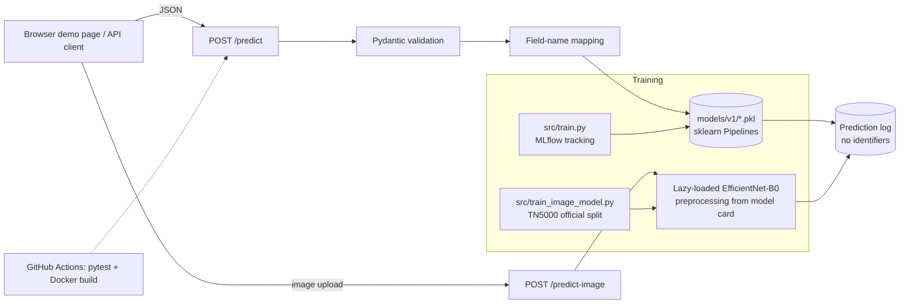

# Thyroid ML System

End-to-end ML system for thyroid disease: **hypothyroidism risk from clinical lab values** (scikit-learn / XGBoost pipelines) and **benign vs malignant classification of thyroid ultrasound images** (EfficientNet-B0), served with FastAPI, tested in CI and deployed on Render.

**Live demo:** [thyroid-ml-system.onrender.com](https://thyroid-ml-system.onrender.com) · **API docs:** [/docs](https://thyroid-ml-system.onrender.com/docs)
<sub>Free tier: the first request after a quiet period takes ~1 minute to wake the server, and the first image prediction loads the model (~20 s, then ~0.3 s per image). Research demo, not a medical device.</sub>

---

## What it does

| Input | Model | Output |
|---|---|---|
| 28 clinical fields (age, sex, TSH, T3, TT4, T4U, FTI, medication/history flags) | RandomForest, XGBoost or LogisticRegression, each a full scikit-learn `Pipeline` (imputation, scaling, one-hot encoding) | `hypothyroid` / `negative` + probability |
| Thyroid ultrasound image (JPG/PNG) | EfficientNet-B0, ImageNet transfer learning | `benign` / `malignant` + class probabilities |

## Architecture



## Results

**Tabular models** (hypothyroid dataset, stratified 80/20 split, ROC-AUC on the held-out 20% as logged in `mlflow.db`):

| Model | Held-out ROC-AUC |
|---|---|
| RandomForest (200 trees) | 1.000 |
| XGBoost | 1.000 (0.99995) |
| LogisticRegression | 0.983 |

The dataset is strongly separable on TSH and FTI, which is why tree models reach ~1.0; LogisticRegression is the more conservative reference point.

**Image model:** being retrained on TN5000's official train/val/test split with [`notebooks/retrain_image_model_tn5000.ipynb`](notebooks/retrain_image_model_tn5000.ipynb). Test-set accuracy, sensitivity, specificity, AUC, the ROC curve and confusion matrix will be published here and at [`/model-card`](https://thyroid-ml-system.onrender.com/model-card) once the run is complete.

## API

| Method | Path | Purpose |
|---|---|---|
| `GET` | `/` | Demo page |
| `POST` | `/predict?model_name=RandomForest\|XGBoost\|LogisticRegression` | Tabular prediction |
| `POST` | `/predict-image` | Image prediction (multipart `file`) |
| `GET` | `/models` | Available tabular models and version |
| `GET` | `/model-card` | How the image model was trained and how it scored |
| `GET` | `/health` | Status, loaded models |

```bash
curl -X POST "https://thyroid-ml-system.onrender.com/predict?model_name=XGBoost" \
  -H "Content-Type: application/json" \
  -d '{"age": 55, "sex": "F", "TSH": 60, "T3": 0.5, "TT4": 40, "T4U": 1.0, "FTI": 40}'
# {"model":"XGBoost","model_version":"v1","prediction":"hypothyroid","probability_hypothyroid":0.9993,...}
```

Only the lab values, age and sex are required; flags default to `"f"`. Inputs are validated (allowed values and physiological ranges) and rejected with `422` if invalid.

## Engineering notes

- **Field mapping bug fixed:** the API exposes `on_thyroxine` but the trained pipelines expect the dataset's column names (`on thyroxine`); requests are mapped explicitly, and tests cover every model.
- **Label semantics made explicit:** training encoded the dataset's majority class `P` as 1, so class 0 is the hypothyroid diagnosis. The API returns a named label and `probability_hypothyroid` instead of a raw class index.
- **Reproducible environment:** Python 3.11, scikit-learn pinned to 1.8.0 (the version the pickles were saved with), CPU-only PyTorch wheels to keep the image small.
- **Fits a 512 MB instance:** PyTorch and the image weights load on the first image request, so the tabular API starts instantly.
- **Model card:** retrained weights ship with `cancer_efficientnet.json` (preprocessing, training settings, val/test metrics); the API reads normalisation from it, so new weights drop in without code changes.
- **Privacy:** prediction logs contain model inputs and outputs only, no names or identifiers.

## Run locally

```bash
git clone https://github.com/lonewolf1621/thyroid-ml-system
cd thyroid-ml-system
python -m venv venv && source venv/bin/activate      # Windows: venv\Scripts\activate
pip install -r requirements.txt
uvicorn api.main:app --reload                       # http://localhost:8000
```

Tests: `pip install -r requirements-dev.txt && pytest -q` · Docker: `docker build -t thyroid-ml . && docker run -p 8000:8000 thyroid-ml`

### Retrain the image model

1. Open [`notebooks/retrain_image_model_tn5000.ipynb`](https://colab.research.google.com/github/lonewolf1621/thyroid-ml-system/blob/main/notebooks/retrain_image_model_tn5000.ipynb) in Colab with a T4 GPU and run all cells (~15 minutes). It downloads TN5000 from [figshare](https://figshare.com/s/cb6a67f17c04b29e7edd) and verifies its checksum.
2. Copy `cancer_efficientnet.pth` and `cancer_efficientnet.json` from `My Drive/thyroid_model_v2` into `image_models/`.

Or locally: `python src/train_image_model.py --data TN5000_forReview.zip --out outputs/`

## Project structure

```
api/            FastAPI app, image model loader, demo page
models/v1/      Tabular pipelines (RandomForest, XGBoost, LogisticRegression)
image_models/   EfficientNet-B0 weights (+ model card after retraining)
src/            Training: train.py (tabular, MLflow), train_image_model.py, tn5000.py
notebooks/      Colab retraining notebook
monitoring/     Data drift report (Evidently)
tests/          API and data tests (pytest, run in GitHub Actions)
```

## Data

- Tabular: thyroid disease (hypothyroid) dataset, Garavan Institute / UCI, as distributed on OpenML.
- Images: TN5000, Zhang H., Liu Q., Han X., Niu L., Sun W. *TN5000: An Ultrasound Image Dataset for Thyroid Nodule Detection and Classification.* Scientific Data 12, 1437 (2025), CC BY. Downloaded at training time rather than stored in this repository.

## Limitations

This is a portfolio project. Neither model is validated for clinical use; images from other scanners and hospitals may perform worse than the reported test set, and the tabular dataset is decades old and small.

---

Author: Vishal Kumar Reddy Gudla · [LinkedIn](https://www.linkedin.com/in/vishalkumar-gudla) · [GitHub](https://github.com/lonewolf1621)
